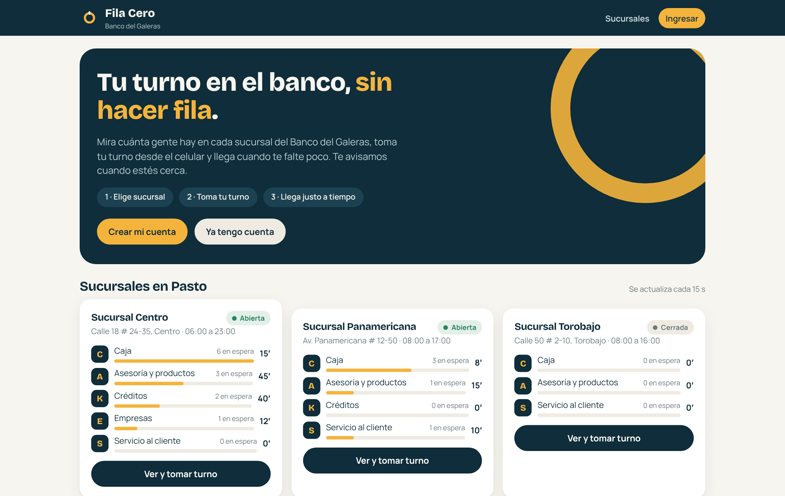
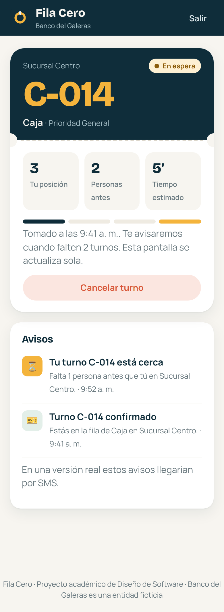
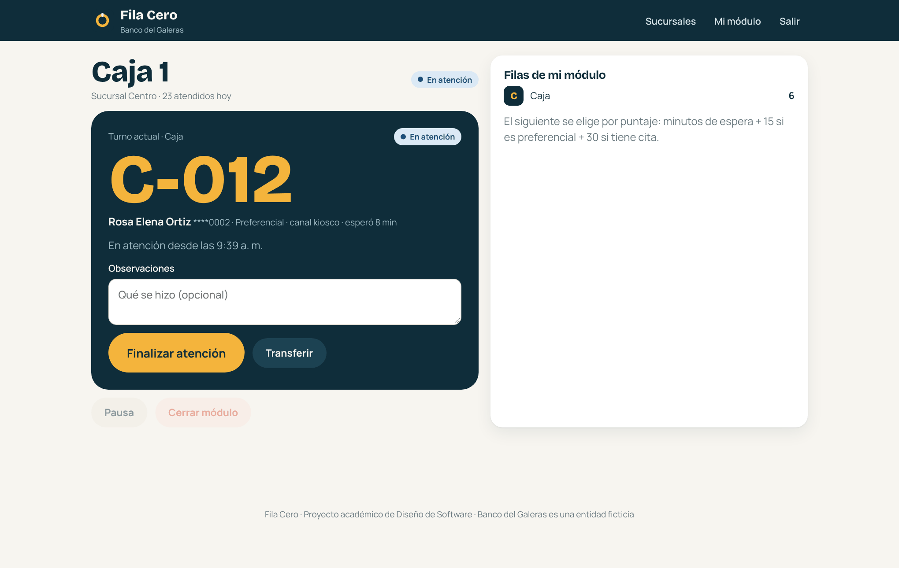
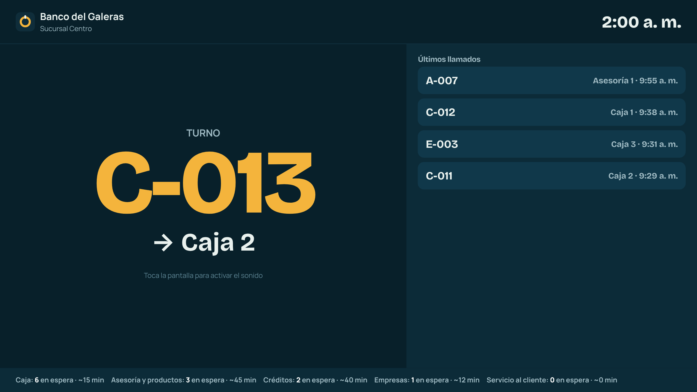
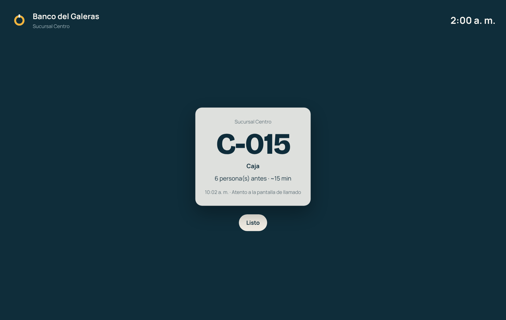
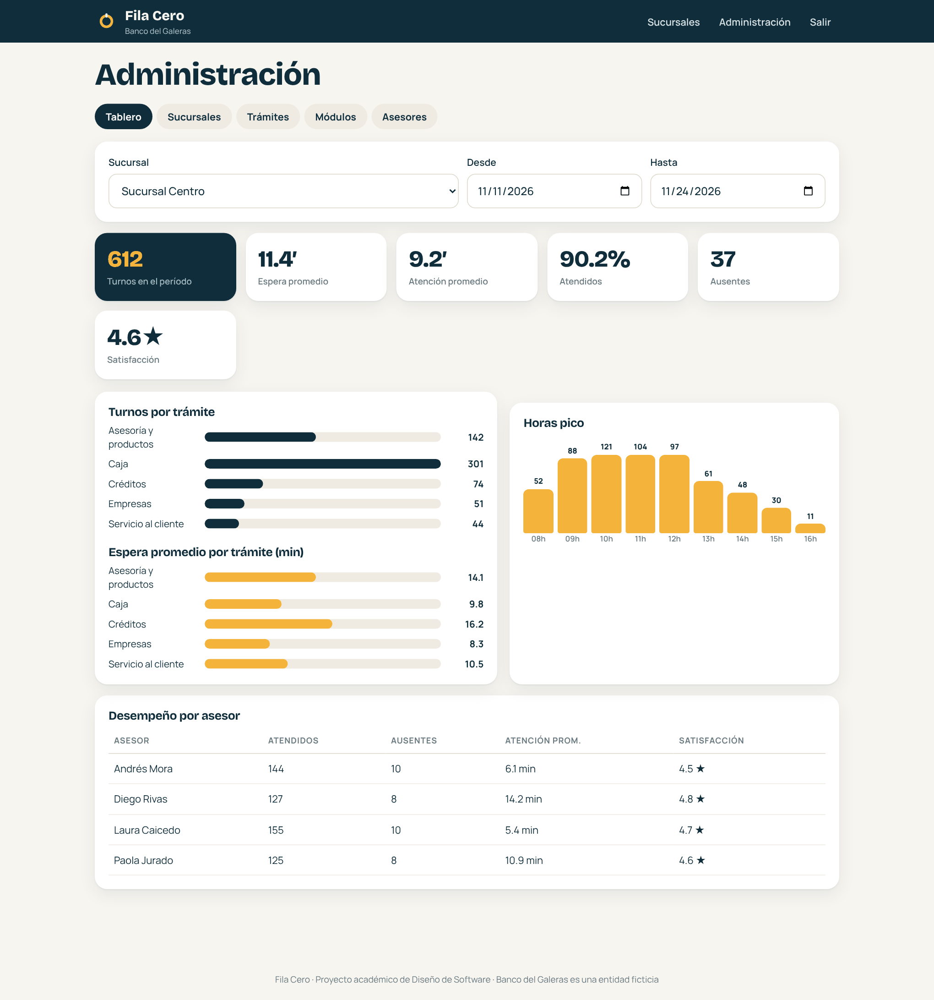

# Fila Cero · Turnos inteligentes para el Banco del Galeras

**Fila Cero** es una plataforma web y móvil para gestionar los turnos de atención en las sucursales de un banco. El cliente ve cuánta gente hay en cada sucursal, toma su turno desde el celular (o en el kiosco con su cédula), sigue su posición en tiempo real y recibe un aviso cuando le falta poco. El asesor llama al siguiente con un botón y el sistema decide a quién atender según una regla de prioridad justa. El gerente ve los indicadores de atención de cada oficina.

> Proyecto final de **Diseño de Software** · Manuel Alejandro Villarreal · 2026.
> El **Banco del Galeras** es una entidad **ficticia** creada para este proyecto académico.

| | Enlace |
|---|---|
| App desplegada | https://fila-cero.vercel.app |
| API desplegada | https://filacero-backend.onrender.com/api/estado |
| Swagger | https://filacero-backend.onrender.com/swagger-ui.html |
| Wiki (SRS) | https://github.com/ManuelVillarreal-l/fila-cero/wiki |
| Historias de usuario | [docs/historias](docs/historias/00-resumen.md) · [Issues](https://github.com/ManuelVillarreal-l/fila-cero/issues) |



## Funcionalidades

| Actor | Qué puede hacer |
|---|---|
| **Visitante** (sin cuenta) | Ver sucursales y el estado de sus filas, tomar turno en el **kiosco** con su cédula, ver la **pantalla de llamado**, registrarse |
| **Cliente** | Tomar **turno virtual**, seguir su **posición y tiempo estimado** en vivo, recibir **avisos**, cancelar, **agendar citas** con check-in, calificar la atención, ver su historial |
| **Asesor** | Abrir, pausar y cerrar su **módulo**, **llamar al siguiente**, volver a llamar, iniciar y finalizar la atención, marcar **ausente**, **transferir** a otro trámite |
| **Administrador** | Gestionar sucursales, trámites, módulos y asesores; consultar el **tablero de indicadores** |
| **Servicio de notificaciones** (externo, simulado) | Entrega los avisos del turno (en producción: SMS) |

### La regla de la cola (RN3)

Cada turno en espera tiene un **puntaje = minutos esperando + bonificación**: General **0**, Preferencial **15** (adulto mayor, embarazo, discapacidad), Cita **30**. Se llama al de mayor puntaje; si empatan, al que llegó primero. Así un adulto mayor pasa adelante, pero un cliente general que lleva mucho tiempo esperando nunca queda relegado para siempre. Las bonificaciones son estrategias intercambiables (patrón **Strategy**), por eso cambiarlas toma un minuto.

**Tiempo estimado (RN4)** = ⌈personas antes × minutos promedio del trámite ÷ módulos abiertos⌉.

Todas las reglas están en [docs/02-requisitos.md](docs/02-requisitos.md).

## Tecnologías

| Capa | Tecnología |
|---|---|
| Backend | Java 17, Spring Boot 3.3.5 (Web, Data MongoDB, Security, Validation), JWT (jjwt 0.12.6), BCrypt, Swagger (springdoc 2.6) |
| Base de datos | MongoDB 7 (MongoDB Atlas en la nube) |
| Pruebas | JUnit 5 + Mockito, Postman/Newman (71 peticiones por historia de usuario) |
| Frontend | React 18 + Vite, React Router, diseño responsive *mobile first* |
| Infraestructura | Docker, Render, Vercel, GitHub Actions (CI y keep-alive) |
| Diseño | Visual Paradigm Community Edition 18.1 |

## Arquitectura

Arquitectura en **tres capas** (cliente, servidor de aplicaciones, base de datos) y, dentro del backend, **por capas** con DTO:

```
Controller (REST)  →  Service (reglas de negocio)  →  Repository (Spring Data)  →  MongoDB
        ↘ DTO ↙                ↘ Modelo de dominio (Turno, ColaAtencion, PoliticaPrioridad…) ↙
```

```
backend/src/main/java/com/filacero/
├── controller/    13 controladores REST (GRASP Controlador)
├── service/       Reglas de negocio: turnos, atención, colas, citas, tablero, oyente de eventos
├── repository/    Interfaces Spring Data MongoDB + contador atómico de turnos
├── model/         Dominio: Usuario (abstracta) → Cliente/Asesor/Administrador, Turno, Cita, ColaAtencion…
│   └── prioridad/ Strategy: PoliticaPrioridad + General/Preferencial/Cita + FabricaPrioridades
├── integracion/   NotificadorTurnos (interfaz) y NotificadorSimulado
├── dto/           *Request / *Response (records)
├── security/      JWT: JwtServicio, FiltroJwt, UsuarioActual
├── exception/     Excepciones de negocio + ManejadorErrores (@RestControllerAdvice)
└── config/        Seguridad, Swagger, reloj (zona Bogotá) y datos de prueba
```

### Patrones aplicados

| Patrón | Dónde |
|---|---|
| GRASP **Controlador** | Cada `*Controller` recibe la petición y delega en su servicio |
| GRASP **Experto** | `Turno.llamar/finalizar/calificar`, `Cliente.esPreferencial`, `Sucursal.estaAbierta`, `Cita.puedeHacerCheckIn`, `ColaAtencion.siguiente/tiempoEstimado`, `Tramite.codigoTurno` |
| GRASP **Creador** | `ReporteIndicadores` crea sus `LineaIndicador`; `TurnoServicio.crear` arma el `Turno` con su código |
| GRASP **Polimorfismo** / GoF **Strategy** | `PoliticaPrioridad` con `PrioridadGeneral`, `PrioridadPreferencial`, `PrioridadCita` |
| GRASP **Fabricación pura** / **Simple Factory** | `FabricaPrioridades.para(tipo)`, `ColaServicio`, repositorios |
| GoF **State** | `EstadoTurno` define las transiciones válidas; `Turno` delega en él |
| GoF **Observer** | Los servicios publican `EventoTurno`; `OyenteTurnos` lo escucha y notifica |
| GRASP **Indirección / Variaciones protegidas** | `NotificadorTurnos` aísla el proveedor de SMS; `PoliticaPrioridad` aísla las reglas de prioridad |
| GoF **Chain of Responsibility** | `FiltroJwt` dentro de la cadena de filtros de Spring Security |
| Repository, DTO, Inyección de dependencias | Toda la aplicación (incluido el `Clock` inyectado) |
| Bloqueo optimista | `@Version` en `Turno`: dos asesores no llaman el mismo turno |

## Diagramas UML (Visual Paradigm)

| Vista | Archivo |
|---|---|
| Contexto (nivel 0) | [diagramas/vista-contexto.png](diagramas/vista-contexto.png) |
| Funcional (componentes) | [diagramas/vista-funcional.png](diagramas/vista-funcional.png) |
| Lógica (clases) | [diagramas/vista-logica.png](diagramas/vista-logica.png) |
| Desarrollo (clases por capas) | [diagramas/vista-desarrollo.png](diagramas/vista-desarrollo.png) |
| Despliegue | [diagramas/vista-despliegue.png](diagramas/vista-despliegue.png) |
| Secuencias y estados | [diagramas/](diagramas/README.md) |

La trazabilidad de cada elemento con las HU y los RF está en [diagramas/README.md](diagramas/README.md).

## Capturas

| Cliente: mi turno | Asesor: mi módulo | Pantalla de llamado |
|---|---|---|
|  |  |  |

| Kiosco | Tablero de indicadores |
|---|---|
|  |  |

## Cómo ejecutarlo

**Con Docker** (MongoDB + backend):

```bash
docker compose up --build        # API en http://localhost:8080 y Swagger en /swagger-ui.html
```

**Sin Docker** (necesitas Java 17, Maven y MongoDB en `localhost:27017`):

```bash
cd backend
mvn spring-boot:run              # API en http://localhost:8080
mvn test                         # pruebas unitarias
```

**Frontend:**

```bash
cd frontend
cp .env.example .env             # VITE_API_URL=http://localhost:8080
npm install
npm run dev                      # http://localhost:5173
```

Al arrancar con la base vacía se cargan 3 sucursales de Pasto, 5 trámites, 11 módulos, las cuentas de prueba y un historial de 14 días para el tablero.

## Cuentas de prueba

| Rol | Correo | Contraseña |
|---|---|---|
| Administrador | admin@filacero.co | Admin123* |
| Cliente | cliente@filacero.co | Cliente123* |
| Cliente adulto mayor (preferencial) | rosa@filacero.co | Cliente123* |
| Cliente con embarazo (preferencial) | ana@filacero.co | Cliente123* |
| Asesores Sucursal Centro | asesor1@filacero.co … asesor4@filacero.co | Asesor123* |
| Asesores Panamericana | asesor5@filacero.co, asesor6@filacero.co | Asesor123* |
| Asesora Torobajo | asesor7@filacero.co | Asesor123* |

Pantallas públicas de una sucursal: `/kiosco/{idSucursal}` y `/pantalla/{idSucursal}` (enlaces en el detalle de cada sucursal).

## Endpoints REST

| Método | Ruta | Rol | HU |
|---|---|---|---|
| POST | `/api/auth/registro` | Público | HU_001 |
| POST | `/api/auth/login` | Público | HU_002 |
| GET | `/api/sucursales`, `/api/sucursales/{id}` | Público | HU_007 |
| POST/PUT/DELETE | `/api/sucursales/{id}` | Administrador | HU_003 |
| GET · POST/PUT/DELETE | `/api/tramites` | Público · Administrador | HU_004 |
| GET · POST/PUT/DELETE | `/api/modulos?sucursalId=` | Admin/Asesor · Administrador | HU_005 |
| GET/POST/PUT/DELETE | `/api/asesores` | Administrador | HU_006 |
| POST | `/api/turnos` | Cliente | HU_008 |
| POST · GET | `/api/kiosco/turnos` · `/api/kiosco/turnos/{id}` | Público | HU_009 |
| GET | `/api/turnos/actual`, `/api/turnos/historial` | Cliente | HU_010 |
| PATCH | `/api/turnos/{id}/cancelar` | Cliente | HU_011 |
| POST | `/api/turnos/{id}/calificacion` | Cliente | HU_019 |
| GET · POST | `/api/atencion/panel` · `/api/atencion/modulo/{abrir,cerrar,pausar,reanudar}` | Asesor | HU_012 |
| POST | `/api/atencion/llamar-siguiente` | Asesor | HU_013 |
| POST | `/api/atencion/turnos/{id}/{rellamar,iniciar,finalizar,ausente}` | Asesor | HU_014 |
| POST | `/api/atencion/turnos/{id}/transferir` | Asesor | HU_015 |
| GET · POST · GET | `/api/citas/franjas` · `/api/citas` · `/api/citas` | Cliente | HU_016 |
| PATCH · POST | `/api/citas/{id}/cancelar` · `/api/citas/{id}/check-in` | Cliente | HU_017 |
| GET | `/api/pantalla/{sucursalId}` | Público | HU_018 |
| GET | `/api/tablero?sucursalId=&desde=&hasta=` | Administrador | HU_020 |
| GET · POST | `/api/notificaciones` · `/api/notificaciones/leidas` | Cliente | RF_021 |

Errores con formato uniforme y mensaje en español: 400 (datos inválidos), 401 (sin sesión o credenciales), 403 (rol o recurso ajeno), 404 (no existe), 409 (regla de negocio), 422 (sucursal cerrada).

## Pruebas

- **Unitarias** (`backend/src/test`): prioridades y fábrica, cola de atención y tiempo estimado, ciclo de vida del turno (State), citas, cliente preferencial, módulo, tablero, `TurnoServicio` y `AtencionServicio` con Mockito.
- **API** (`postman/`): 71 peticiones organizadas por HU con aserciones automáticas. Importa `FilaCero.postman_collection.json` y el entorno `FilaCero-Local` o `FilaCero-Render`.
- **CI** (`.github/workflows/ci.yml`): en cada push compila, corre las pruebas unitarias, levanta la API contra un MongoDB real y ejecuta la colección con Newman; también compila el frontend.

## Despliegue

| Parte | Plataforma | Configuración |
|---|---|---|
| Backend | Render (Docker, plan gratis) | `render.yaml` + `backend/Dockerfile`. Variables: `MONGODB_URI`, `JWT_SECRET`, `CORS_ORIGENES`, `DATOS_PRUEBA` |
| Base de datos | MongoDB Atlas M0 | La cadena de conexión **no** está en el repositorio |
| Frontend | Vercel | Carpeta raíz `frontend`, variable `VITE_API_URL` |

El plan gratis de Render duerme el servicio tras 15 minutos; `keep-alive.yml` lo visita cada 10 minutos de 6 a. m. a 10 p. m.

## Autor

**Manuel Alejandro Villarreal** · Diseño de Software · 2026
