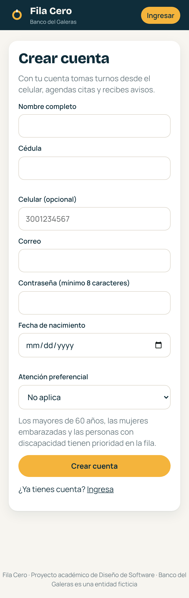

# HU_001 · Registrarse como cliente

| Épica | Actor | Prioridad | Puntos | Sprint | Requisitos | Issue |
|---|---|---|---|---|---|---|
| 1. Cuenta | Visitante | Alta | 3 | 1 | RF_001 | [#1](https://github.com/ManuelVillarreal-l/fila-cero/issues/1) |

## Historia

**Como** visitante del Banco del Galeras,  
**quiero** crear una cuenta con mi cédula, correo y contraseña,  
**para** tomar turnos desde el celular y recibir avisos.

## Criterios de aceptación

```gherkin
Característica: Registrarse como cliente

  Escenario: Registro exitoso
    Dado que estoy en la pantalla de registro
    Cuando ingreso nombre, cédula, correo y una contraseña de al menos 8 caracteres
    Entonces se crea mi cuenta de cliente
    Y quedo con la sesión iniciada

  Escenario: Correo o cédula repetidos
    Dado que ya existe una cuenta con el correo "cliente@filacero.co"
    Cuando intento registrarme con ese correo
    Entonces veo el mensaje "Ya existe una cuenta con el correo cliente@filacero.co"
    Y no se crea otra cuenta

  Escenario: Datos inválidos
    Dado que estoy en la pantalla de registro
    Cuando dejo el nombre vacío o escribo un correo sin formato válido
    Entonces veo junto a cada campo qué debo corregir

  Escenario: Atención preferencial
    Dado que tengo 60 años o más, o indico embarazo o discapacidad
    Cuando completo el registro
    Entonces mis turnos se tomarán con prioridad preferencial
```

## Supuestos y notas

- La contraseña se guarda cifrada con BCrypt.
- La cédula tiene entre 6 y 12 dígitos.

## Validación INVEST

| Criterio | Cumple | Justificación |
|---|---|---|
| Independiente | Sí | Se puede construir y probar sin esperar otras historias de su épica. |
| Negociable | Sí | Describe el qué y el para qué; los detalles de interfaz se acuerdan. |
| Valiosa | Sí | Aporta valor directo a: Visitante. |
| Estimable | Sí | 3 puntos de historia. |
| Pequeña | Sí | Cabe en un sprint de una semana. |
| Testeable | Sí | Tiene criterios Gherkin verificables y pruebas en Postman. |

## Mockup


