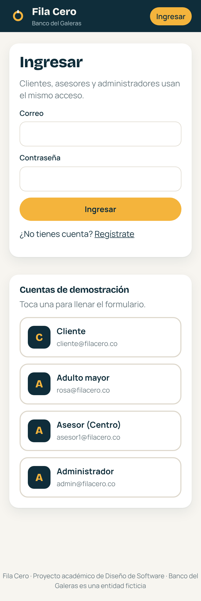

# HU_002 · Iniciar sesión

| Épica | Actor | Prioridad | Puntos | Sprint | Requisitos | Issue |
|---|---|---|---|---|---|---|
| 1. Cuenta | Cliente, Asesor, Administrador | Alta | 3 | 1 | RF_002 | [#2](https://github.com/ManuelVillarreal-l/fila-cero/issues/2) |

## Historia

**Como** usuario registrado,  
**quiero** iniciar sesión con mi correo y contraseña,  
**para** usar las funciones de mi rol.

## Criterios de aceptación

```gherkin
Característica: Iniciar sesión

  Escenario: Credenciales correctas
    Dado que tengo una cuenta activa
    Cuando ingreso mi correo y contraseña
    Entonces entro a la pantalla de mi rol (Mi turno, Mi módulo o Administración)

  Escenario: Credenciales incorrectas
    Dado que escribo mal la contraseña
    Cuando intento ingresar
    Entonces veo "Correo o contraseña incorrectos"
    Y no se indica cuál de los dos falló

  Escenario: Acceso según el rol
    Dado que inicié sesión como cliente
    Cuando intento entrar al panel del asesor
    Entonces el sistema me lo impide
```

## Supuestos y notas

- La sesión dura 12 horas (token JWT).

## Validación INVEST

| Criterio | Cumple | Justificación |
|---|---|---|
| Independiente | Sí | Se puede construir y probar sin esperar otras historias de su épica. |
| Negociable | Sí | Describe el qué y el para qué; los detalles de interfaz se acuerdan. |
| Valiosa | Sí | Aporta valor directo a: Cliente, Asesor, Administrador. |
| Estimable | Sí | 3 puntos de historia. |
| Pequeña | Sí | Cabe en un sprint de una semana. |
| Testeable | Sí | Tiene criterios Gherkin verificables y pruebas en Postman. |

## Mockup


