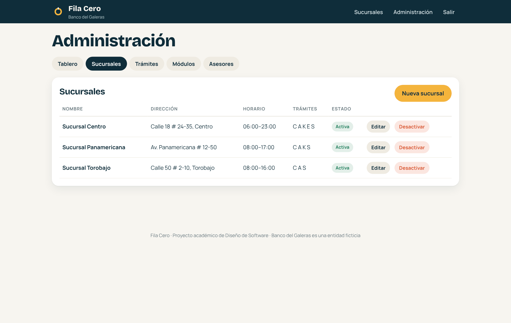

# HU_003 · Gestionar sucursales

| Épica | Actor | Prioridad | Puntos | Sprint | Requisitos | Issue |
|---|---|---|---|---|---|---|
| 2. Administración | Administrador | Alta | 3 | 1 | RF_003 | [#3](https://github.com/ManuelVillarreal-l/fila-cero/issues/3) |

## Historia

**Como** administrador,  
**quiero** crear, editar y desactivar sucursales con su horario y sus trámites,  
**para** que los clientes vean dónde y cuándo pueden ser atendidos.

## Criterios de aceptación

```gherkin
Característica: Gestionar sucursales

  Escenario: Crear sucursal
    Dado que estoy en Administración > Sucursales
    Cuando registro nombre, dirección, horario y al menos un trámite
    Entonces la sucursal aparece en la lista pública

  Escenario: Horario inválido
    Dado que estoy creando una sucursal
    Cuando la hora de apertura es posterior a la de cierre
    Entonces veo "La hora de apertura debe ser anterior a la de cierre"

  Escenario: Desactivar
    Dado que una sucursal cerró
    Cuando la desactivo
    Entonces deja de aparecer para los clientes
    Y su historial de turnos se conserva
```

## Supuestos y notas

- Una sucursal no se borra: se desactiva.

## Validación INVEST

| Criterio | Cumple | Justificación |
|---|---|---|
| Independiente | Sí | Se puede construir y probar sin esperar otras historias de su épica. |
| Negociable | Sí | Describe el qué y el para qué; los detalles de interfaz se acuerdan. |
| Valiosa | Sí | Aporta valor directo a: Administrador. |
| Estimable | Sí | 3 puntos de historia. |
| Pequeña | Sí | Cabe en un sprint de una semana. |
| Testeable | Sí | Tiene criterios Gherkin verificables y pruebas en Postman. |

## Mockup


