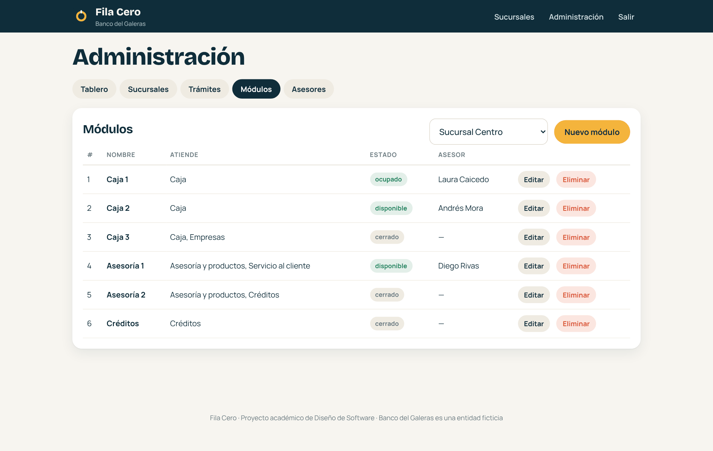

# HU_005 · Gestionar módulos de atención

| Épica | Actor | Prioridad | Puntos | Sprint | Requisitos | Issue |
|---|---|---|---|---|---|---|
| 2. Administración | Administrador | Alta | 2 | 1 | RF_005 | [#5](https://github.com/ManuelVillarreal-l/fila-cero/issues/5) |

## Historia

**Como** administrador,  
**quiero** crear las ventanillas de cada sucursal e indicar qué trámites atiende cada una,  
**para** que cada asesor llame solo los turnos que le corresponden.

## Criterios de aceptación

```gherkin
Característica: Gestionar módulos de atención

  Escenario: Crear módulo
    Dado que la sucursal Centro ofrece Caja y Empresas
    Cuando creo el módulo 3 "Caja 3" que atiende Caja y Empresas
    Entonces aparece en la lista de módulos de la sucursal

  Escenario: Trámite no ofrecido
    Dado que la sucursal Torobajo no ofrece Créditos
    Cuando intento crear un módulo de Créditos en Torobajo
    Entonces el sistema lo rechaza

  Escenario: Eliminar
    Dado que un módulo está abierto por un asesor
    Cuando intento eliminarlo
    Entonces veo "Solo se puede eliminar un módulo cerrado"
```

## Supuestos y notas

- El número de módulo es único dentro de la sucursal.

## Validación INVEST

| Criterio | Cumple | Justificación |
|---|---|---|
| Independiente | Sí | Se puede construir y probar sin esperar otras historias de su épica. |
| Negociable | Sí | Describe el qué y el para qué; los detalles de interfaz se acuerdan. |
| Valiosa | Sí | Aporta valor directo a: Administrador. |
| Estimable | Sí | 2 puntos de historia. |
| Pequeña | Sí | Cabe en un sprint de una semana. |
| Testeable | Sí | Tiene criterios Gherkin verificables y pruebas en Postman. |

## Mockup


