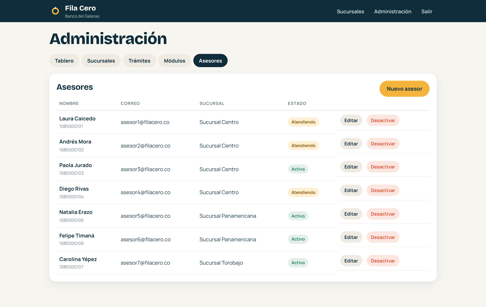

# HU_006 · Gestionar asesores

| Épica | Actor | Prioridad | Puntos | Sprint | Requisitos | Issue |
|---|---|---|---|---|---|---|
| 2. Administración | Administrador | Alta | 2 | 1 | RF_006 | [#6](https://github.com/ManuelVillarreal-l/fila-cero/issues/6) |

## Historia

**Como** administrador,  
**quiero** crear las cuentas de los asesores y asignarlos a una sucursal,  
**para** controlar quién atiende en cada oficina.

## Criterios de aceptación

```gherkin
Característica: Gestionar asesores

  Escenario: Crear asesor
    Dado que estoy en Administración > Asesores
    Cuando registro nombre, cédula, correo, contraseña y sucursal
    Entonces el asesor puede iniciar sesión y abrir módulos de esa sucursal

  Escenario: Desactivar con módulo abierto
    Dado que el asesor está atendiendo en un módulo
    Cuando intento desactivarlo
    Entonces veo que primero debe cerrar el módulo
```

## Supuestos y notas

- Los asesores no se registran solos.

## Validación INVEST

| Criterio | Cumple | Justificación |
|---|---|---|
| Independiente | Sí | Se puede construir y probar sin esperar otras historias de su épica. |
| Negociable | Sí | Describe el qué y el para qué; los detalles de interfaz se acuerdan. |
| Valiosa | Sí | Aporta valor directo a: Administrador. |
| Estimable | Sí | 2 puntos de historia. |
| Pequeña | Sí | Cabe en un sprint de una semana. |
| Testeable | Sí | Tiene criterios Gherkin verificables y pruebas en Postman. |

## Mockup


