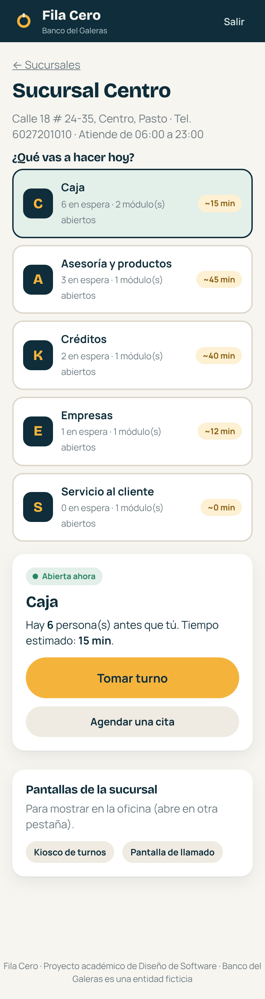

# HU_008 · Tomar turno virtual

| Épica | Actor | Prioridad | Puntos | Sprint | Requisitos | Issue |
|---|---|---|---|---|---|---|
| 3. Turnos (principal) | Cliente | Alta | 5 | 2 | RF_008 | [#8](https://github.com/ManuelVillarreal-l/fila-cero/issues/8) |

## Historia

**Como** cliente,  
**quiero** tomar un turno desde el celular para un trámite de una sucursal,  
**para** no tener que hacer la fila físicamente.

## Criterios de aceptación

```gherkin
Característica: Tomar turno virtual

  Escenario: Turno tomado
    Dado que la sucursal Centro está abierta
    Cuando tomo turno de Caja
    Entonces recibo un código como "C-007"
    Y veo mi posición y el tiempo estimado

  Escenario: Solo un turno activo
    Dado que ya tengo el turno C-007 en espera
    Cuando intento tomar otro turno
    Entonces veo que ya tengo un turno activo

  Escenario: Fuera de horario
    Dado que la sucursal está cerrada
    Cuando intento tomar turno
    Entonces veo el horario de atención y la opción de agendar cita

  Escenario: Prioridad preferencial
    Dado que soy adulto mayor
    Cuando tomo turno
    Entonces mi turno tiene prioridad preferencial
```

## Supuestos y notas

- Los códigos se reinician cada día por sucursal y trámite.

## Validación INVEST

| Criterio | Cumple | Justificación |
|---|---|---|
| Independiente | Sí | Se puede construir y probar sin esperar otras historias de su épica. |
| Negociable | Sí | Describe el qué y el para qué; los detalles de interfaz se acuerdan. |
| Valiosa | Sí | Aporta valor directo a: Cliente. |
| Estimable | Sí | 5 puntos de historia. |
| Pequeña | Sí | Cabe en un sprint de una semana. |
| Testeable | Sí | Tiene criterios Gherkin verificables y pruebas en Postman. |

## Mockup


