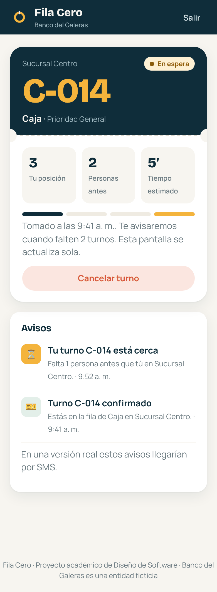

# HU_010 · Seguir mi turno en tiempo real

| Épica | Actor | Prioridad | Puntos | Sprint | Requisitos | Issue |
|---|---|---|---|---|---|---|
| 3. Turnos (principal) | Cliente | Alta | 3 | 2 | RF_010, RF_021, RF_022 | [#10](https://github.com/ManuelVillarreal-l/fila-cero/issues/10) |

## Historia

**Como** cliente con turno,  
**quiero** ver mi posición, el tiempo estimado y recibir avisos,  
**para** llegar a la sucursal justo cuando me toque.

## Criterios de aceptación

```gherkin
Característica: Seguir mi turno en tiempo real

  Escenario: Posición actualizada
    Dado que tengo un turno en espera
    Cuando atienden a las personas que van antes
    Entonces mi posición y el tiempo estimado bajan solos

  Escenario: Aviso de turno próximo
    Dado que tengo un turno en espera
    Cuando faltan 2 turnos o menos para el mío
    Entonces recibo el aviso "Tu turno está cerca"

  Escenario: Me llaman
    Dado que el asesor llama mi turno
    Cuando miro la app
    Entonces veo "¡Es tu turno!" y el módulo al que debo acercarme

  Escenario: Historial
    Dado que ya tuve turnos
    Cuando abro el historial
    Entonces veo cada turno con su estado, fecha y asesor
```

## Supuestos y notas

- Los avisos se simulan dentro de la app; en producción irían por SMS.

## Validación INVEST

| Criterio | Cumple | Justificación |
|---|---|---|
| Independiente | Sí | Se puede construir y probar sin esperar otras historias de su épica. |
| Negociable | Sí | Describe el qué y el para qué; los detalles de interfaz se acuerdan. |
| Valiosa | Sí | Aporta valor directo a: Cliente. |
| Estimable | Sí | 3 puntos de historia. |
| Pequeña | Sí | Cabe en un sprint de una semana. |
| Testeable | Sí | Tiene criterios Gherkin verificables y pruebas en Postman. |

## Mockup


