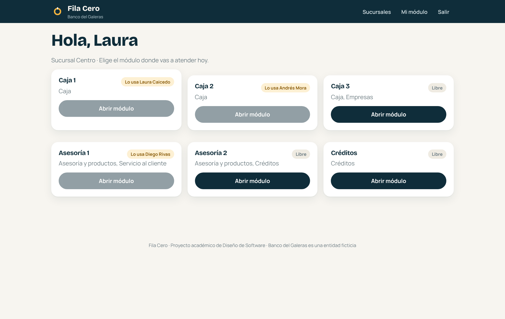

# HU_012 · Abrir y cerrar mi módulo

| Épica | Actor | Prioridad | Puntos | Sprint | Requisitos | Issue |
|---|---|---|---|---|---|---|
| 4. Atención en ventanilla | Asesor | Alta | 2 | 3 | RF_012 | [#12](https://github.com/ManuelVillarreal-l/fila-cero/issues/12) |

## Historia

**Como** asesor,  
**quiero** abrir, pausar y cerrar el módulo donde atiendo,  
**para** recibir turnos solo cuando estoy disponible.

## Criterios de aceptación

```gherkin
Característica: Abrir y cerrar mi módulo

  Escenario: Abrir módulo
    Dado que inicié sesión como asesor de la sucursal Centro
    Cuando abro el módulo "Caja 1"
    Entonces el módulo queda disponible
    Y cuenta para el tiempo estimado de su fila

  Escenario: Módulo ocupado
    Dado que otro asesor tiene abierta la Caja 1
    Cuando intento abrirla
    Entonces veo quién la está usando

  Escenario: Cerrar con atención en curso
    Dado que estoy atendiendo un turno
    Cuando intento cerrar o pausar el módulo
    Entonces el sistema me pide finalizar la atención primero
```

## Supuestos y notas

- Un asesor solo abre módulos de su sucursal y uno a la vez.

## Validación INVEST

| Criterio | Cumple | Justificación |
|---|---|---|
| Independiente | Sí | Se puede construir y probar sin esperar otras historias de su épica. |
| Negociable | Sí | Describe el qué y el para qué; los detalles de interfaz se acuerdan. |
| Valiosa | Sí | Aporta valor directo a: Asesor. |
| Estimable | Sí | 2 puntos de historia. |
| Pequeña | Sí | Cabe en un sprint de una semana. |
| Testeable | Sí | Tiene criterios Gherkin verificables y pruebas en Postman. |

## Mockup


