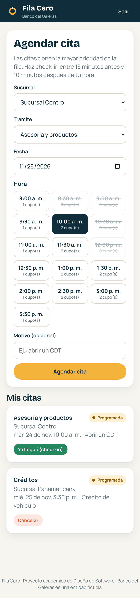

# HU_016 · Agendar cita

| Épica | Actor | Prioridad | Puntos | Sprint | Requisitos | Issue |
|---|---|---|---|---|---|---|
| 5. Citas | Cliente | Media | 5 | 4 | RF_016 | [#16](https://github.com/ManuelVillarreal-l/fila-cero/issues/16) |

## Historia

**Como** cliente,  
**quiero** reservar una cita para un día y una hora,  
**para** ser atendido con prioridad sin esperar.

## Criterios de aceptación

```gherkin
Característica: Agendar cita

  Escenario: Ver franjas
    Dado que elijo sucursal, trámite y fecha
    Cuando consulto las horas
    Entonces veo franjas de 30 minutos con sus cupos

  Escenario: Agendar
    Dado que la franja de las 10:00 tiene cupo
    Cuando la reservo
    Entonces mi cita queda programada

  Escenario: Sin cupo o fuera de franja
    Dado que la franja está llena o la hora no es en punto o y media
    Cuando intento reservar
    Entonces el sistema me pide elegir otra hora
```

## Supuestos y notas

- Los cupos de una franja son los módulos que atienden el trámite.
- Se agenda con hasta 30 días de anticipación.

## Validación INVEST

| Criterio | Cumple | Justificación |
|---|---|---|
| Independiente | Sí | Se puede construir y probar sin esperar otras historias de su épica. |
| Negociable | Sí | Describe el qué y el para qué; los detalles de interfaz se acuerdan. |
| Valiosa | Sí | Aporta valor directo a: Cliente. |
| Estimable | Sí | 5 puntos de historia. |
| Pequeña | Sí | Cabe en un sprint de una semana. |
| Testeable | Sí | Tiene criterios Gherkin verificables y pruebas en Postman. |

## Mockup


