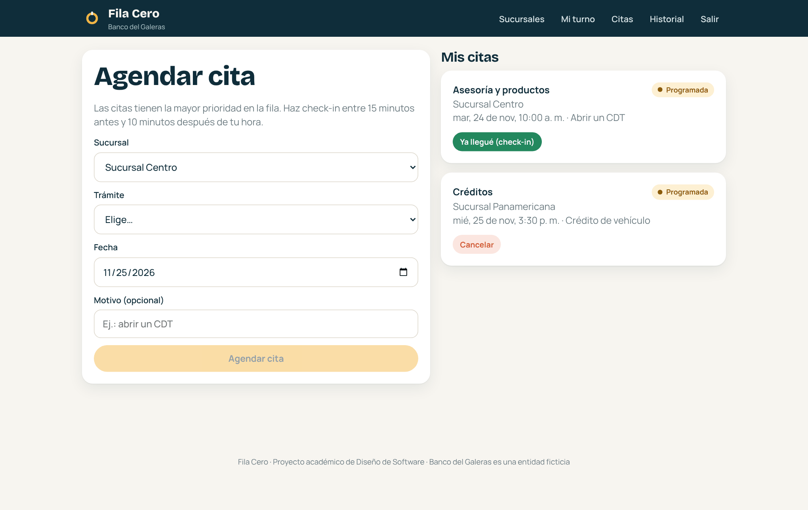

# HU_017 · Hacer check-in o cancelar la cita

| Épica | Actor | Prioridad | Puntos | Sprint | Requisitos | Issue |
|---|---|---|---|---|---|---|
| 5. Citas | Cliente | Media | 3 | 4 | RF_017 | [#17](https://github.com/ManuelVillarreal-l/fila-cero/issues/17) |

## Historia

**Como** cliente con cita,  
**quiero** avisar que llegué o cancelar la cita,  
**para** recibir mi turno prioritario o liberar el cupo.

## Criterios de aceptación

```gherkin
Característica: Hacer check-in o cancelar la cita

  Escenario: Check-in a tiempo
    Dado que mi cita es a las 10:00
    Cuando hago check-in entre las 9:45 y las 10:10
    Entonces recibo un turno con prioridad de cita

  Escenario: Check-in temprano o tarde
    Dado que mi cita es a las 10:00
    Cuando intento el check-in a las 9:00 o a las 10:30
    Entonces veo que aún no se habilita o que la cita venció

  Escenario: Cancelar
    Dado que falta más de 1 hora
    Cuando cancelo la cita
    Entonces el cupo queda libre
```

## Supuestos y notas

- Las citas sin check-in se marcan vencidas automáticamente.

## Validación INVEST

| Criterio | Cumple | Justificación |
|---|---|---|
| Independiente | Sí | Se puede construir y probar sin esperar otras historias de su épica. |
| Negociable | Sí | Describe el qué y el para qué; los detalles de interfaz se acuerdan. |
| Valiosa | Sí | Aporta valor directo a: Cliente. |
| Estimable | Sí | 3 puntos de historia. |
| Pequeña | Sí | Cabe en un sprint de una semana. |
| Testeable | Sí | Tiene criterios Gherkin verificables y pruebas en Postman. |

## Mockup


