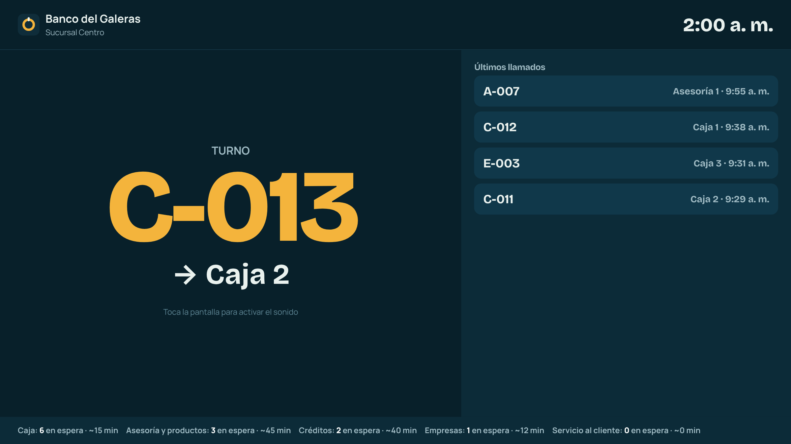

# HU_018 · Ver la pantalla de llamado

| Épica | Actor | Prioridad | Puntos | Sprint | Requisitos | Issue |
|---|---|---|---|---|---|---|
| 6. Seguimiento | Visitante, Cliente | Media | 2 | 3 | RF_018 | [#18](https://github.com/ManuelVillarreal-l/fila-cero/issues/18) |

## Historia

**Como** persona en la sala de espera,  
**quiero** ver en una pantalla qué turno llaman y a qué módulo,  
**para** saber cuándo acercarme.

## Criterios de aceptación

```gherkin
Característica: Ver la pantalla de llamado

  Escenario: Nuevo llamado
    Dado que la pantalla de la sucursal está abierta
    Cuando un asesor llama un turno
    Entonces el código y el módulo aparecen en grande con sonido y voz

  Escenario: Historial y filas
    Dado que la pantalla está abierta
    Cuando la miro
    Entonces veo los últimos llamados y cuántas personas hay en cada fila
```

## Supuestos y notas

- La pantalla se actualiza cada 3 segundos y no necesita cuenta.

## Validación INVEST

| Criterio | Cumple | Justificación |
|---|---|---|
| Independiente | Sí | Se puede construir y probar sin esperar otras historias de su épica. |
| Negociable | Sí | Describe el qué y el para qué; los detalles de interfaz se acuerdan. |
| Valiosa | Sí | Aporta valor directo a: Visitante, Cliente. |
| Estimable | Sí | 2 puntos de historia. |
| Pequeña | Sí | Cabe en un sprint de una semana. |
| Testeable | Sí | Tiene criterios Gherkin verificables y pruebas en Postman. |

## Mockup


