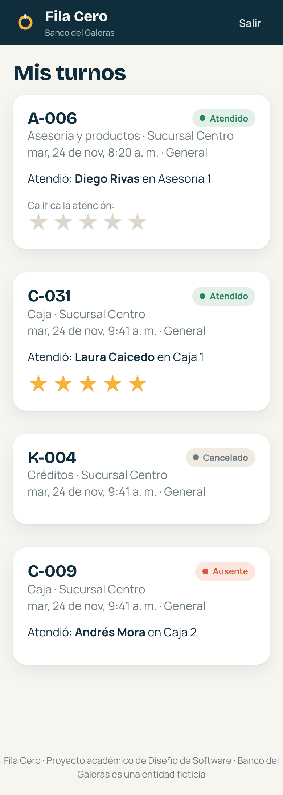

# HU_019 · Calificar la atención

| Épica | Actor | Prioridad | Puntos | Sprint | Requisitos | Issue |
|---|---|---|---|---|---|---|
| 6. Seguimiento | Cliente | Baja | 2 | 4 | RF_019 | [#19](https://github.com/ManuelVillarreal-l/fila-cero/issues/19) |

## Historia

**Como** cliente atendido,  
**quiero** calificar la atención de 1 a 5 estrellas,  
**para** que el banco mejore el servicio.

## Criterios de aceptación

```gherkin
Característica: Calificar la atención

  Escenario: Calificar
    Dado que mi turno fue atendido
    Cuando le doy 5 estrellas y un comentario
    Entonces la calificación queda guardada

  Escenario: Una sola vez
    Dado que ya califiqué el turno
    Cuando intento calificarlo otra vez
    Entonces veo "Este turno ya fue calificado"
```

## Supuestos y notas

- Solo se califican turnos atendidos.

## Validación INVEST

| Criterio | Cumple | Justificación |
|---|---|---|
| Independiente | Sí | Se puede construir y probar sin esperar otras historias de su épica. |
| Negociable | Sí | Describe el qué y el para qué; los detalles de interfaz se acuerdan. |
| Valiosa | Sí | Aporta valor directo a: Cliente. |
| Estimable | Sí | 2 puntos de historia. |
| Pequeña | Sí | Cabe en un sprint de una semana. |
| Testeable | Sí | Tiene criterios Gherkin verificables y pruebas en Postman. |

## Mockup


