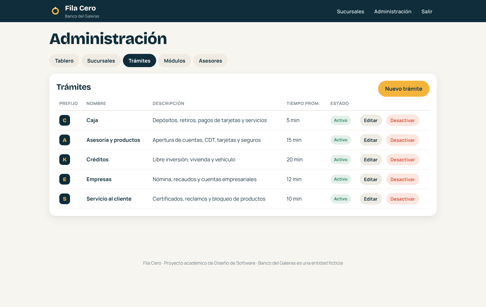

# HU_004 · Gestionar trámites

| Épica | Actor | Prioridad | Puntos | Sprint | Requisitos | Issue |
|---|---|---|---|---|---|---|
| 2. Administración | Administrador | Alta | 2 | 1 | RF_004 | [#4](https://github.com/ManuelVillarreal-l/fila-cero/issues/4) |

## Historia

**Como** administrador,  
**quiero** definir los trámites con su letra y su tiempo promedio de atención,  
**para** armar los códigos de turno y calcular los tiempos de espera.

## Criterios de aceptación

```gherkin
Característica: Gestionar trámites

  Escenario: Crear trámite
    Dado que estoy en Administración > Trámites
    Cuando registro el prefijo "D", el nombre "Divisas" y 8 minutos
    Entonces los turnos de ese trámite se numeran D-001, D-002…

  Escenario: Prefijo repetido
    Dado que ya existe el trámite con prefijo "C"
    Cuando creo otro con "C"
    Entonces veo "Ya hay un trámite con el prefijo C"
```

## Supuestos y notas

- El prefijo es una letra mayúscula.
- El tiempo promedio va de 1 a 120 minutos.

## Validación INVEST

| Criterio | Cumple | Justificación |
|---|---|---|
| Independiente | Sí | Se puede construir y probar sin esperar otras historias de su épica. |
| Negociable | Sí | Describe el qué y el para qué; los detalles de interfaz se acuerdan. |
| Valiosa | Sí | Aporta valor directo a: Administrador. |
| Estimable | Sí | 2 puntos de historia. |
| Pequeña | Sí | Cabe en un sprint de una semana. |
| Testeable | Sí | Tiene criterios Gherkin verificables y pruebas en Postman. |

## Mockup


