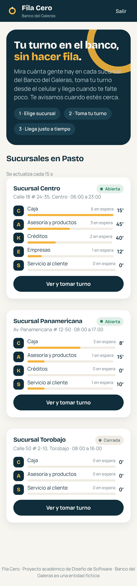

# HU_007 · Consultar sucursales y estado de las filas

| Épica | Actor | Prioridad | Puntos | Sprint | Requisitos | Issue |
|---|---|---|---|---|---|---|
| 3. Turnos (principal) | Visitante, Cliente | Alta | 3 | 2 | RF_007 | [#7](https://github.com/ManuelVillarreal-l/fila-cero/issues/7) |

## Historia

**Como** visitante o cliente,  
**quiero** ver las sucursales con cuántas personas hay en cada fila y el tiempo estimado,  
**para** elegir a dónde ir y cuándo.

## Criterios de aceptación

```gherkin
Característica: Consultar sucursales y estado de las filas

  Escenario: Ver sucursales
    Dado que abro Fila Cero
    Cuando consulto las sucursales
    Entonces veo para cada una si está abierta, su horario y sus trámites
    Y para cada trámite las personas en espera y el tiempo estimado

  Escenario: Tiempo estimado
    Dado que en Caja hay 4 personas, el promedio es 5 minutos y hay 2 cajas abiertas
    Cuando consulto la sucursal
    Entonces el tiempo estimado para un turno nuevo es 10 minutos
```

## Supuestos y notas

- La información se actualiza cada 15 segundos.

## Validación INVEST

| Criterio | Cumple | Justificación |
|---|---|---|
| Independiente | Sí | Se puede construir y probar sin esperar otras historias de su épica. |
| Negociable | Sí | Describe el qué y el para qué; los detalles de interfaz se acuerdan. |
| Valiosa | Sí | Aporta valor directo a: Visitante, Cliente. |
| Estimable | Sí | 3 puntos de historia. |
| Pequeña | Sí | Cabe en un sprint de una semana. |
| Testeable | Sí | Tiene criterios Gherkin verificables y pruebas en Postman. |

## Mockup


