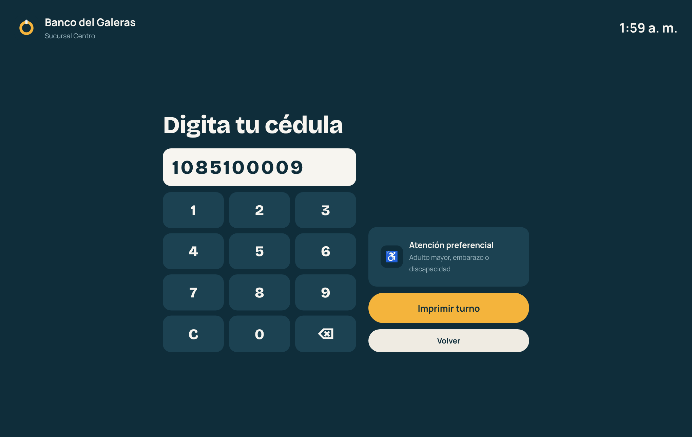

# HU_009 · Tomar turno en el kiosco

| Épica | Actor | Prioridad | Puntos | Sprint | Requisitos | Issue |
|---|---|---|---|---|---|---|
| 3. Turnos (principal) | Visitante | Alta | 3 | 2 | RF_009 | [#9](https://github.com/ManuelVillarreal-l/fila-cero/issues/9) |

## Historia

**Como** persona que llega a la sucursal sin cuenta,  
**quiero** tomar turno en el kiosco con mi cédula,  
**para** ser atendido aunque no use la app.

## Criterios de aceptación

```gherkin
Característica: Tomar turno en el kiosco

  Escenario: Imprimir turno
    Dado que estoy frente al kiosco de la sucursal
    Cuando elijo el trámite y digito mi cédula
    Entonces veo mi tiquete con el código, las personas antes de mí y el tiempo estimado

  Escenario: Preferencial
    Dado que soy adulto mayor, estoy embarazada o tengo una discapacidad
    Cuando marco "Atención preferencial"
    Entonces el turno se crea con prioridad preferencial

  Escenario: Cédula con turno activo
    Dado que mi cédula ya tiene un turno activo en esta sucursal
    Cuando intento tomar otro
    Entonces el kiosco me lo indica
```

## Supuestos y notas

- Si la cédula pertenece a un cliente registrado, el turno queda enlazado a su cuenta.
- El documento se muestra enmascarado (****1234).

## Validación INVEST

| Criterio | Cumple | Justificación |
|---|---|---|
| Independiente | Sí | Se puede construir y probar sin esperar otras historias de su épica. |
| Negociable | Sí | Describe el qué y el para qué; los detalles de interfaz se acuerdan. |
| Valiosa | Sí | Aporta valor directo a: Visitante. |
| Estimable | Sí | 3 puntos de historia. |
| Pequeña | Sí | Cabe en un sprint de una semana. |
| Testeable | Sí | Tiene criterios Gherkin verificables y pruebas en Postman. |

## Mockup


