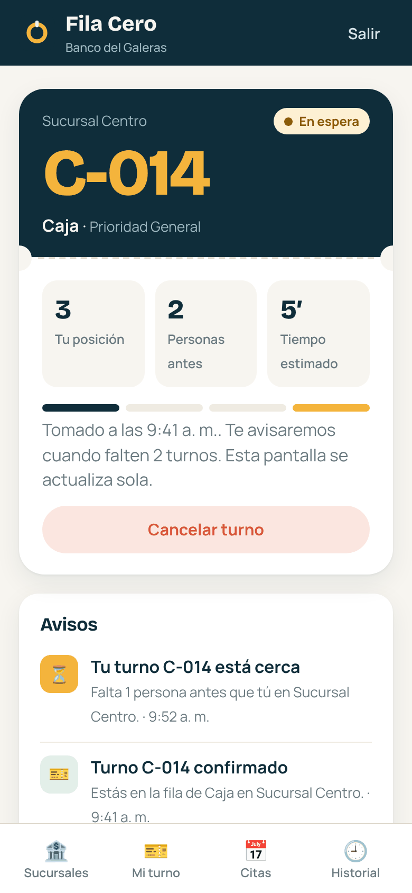

# HU_011 · Cancelar turno

| Épica | Actor | Prioridad | Puntos | Sprint | Requisitos | Issue |
|---|---|---|---|---|---|---|
| 3. Turnos (principal) | Cliente | Media | 2 | 2 | RF_011 | [#11](https://github.com/ManuelVillarreal-l/fila-cero/issues/11) |

## Historia

**Como** cliente,  
**quiero** cancelar mi turno si ya no puedo ir,  
**para** liberar mi lugar en la fila.

## Criterios de aceptación

```gherkin
Característica: Cancelar turno

  Escenario: Cancelar en espera
    Dado que mi turno está en espera
    Cuando lo cancelo y confirmo
    Entonces queda cancelado y sale de la fila

  Escenario: Turno ya llamado
    Dado que mi turno ya fue llamado
    Cuando intento cancelarlo
    Entonces el sistema no lo permite
```

## Supuestos y notas

- Solo el dueño del turno puede cancelarlo.

## Validación INVEST

| Criterio | Cumple | Justificación |
|---|---|---|
| Independiente | Sí | Se puede construir y probar sin esperar otras historias de su épica. |
| Negociable | Sí | Describe el qué y el para qué; los detalles de interfaz se acuerdan. |
| Valiosa | Sí | Aporta valor directo a: Cliente. |
| Estimable | Sí | 2 puntos de historia. |
| Pequeña | Sí | Cabe en un sprint de una semana. |
| Testeable | Sí | Tiene criterios Gherkin verificables y pruebas en Postman. |

## Mockup


