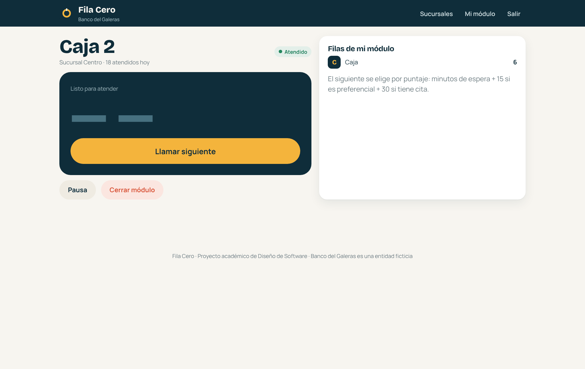

# HU_013 · Llamar al siguiente turno

| Épica | Actor | Prioridad | Puntos | Sprint | Requisitos | Issue |
|---|---|---|---|---|---|---|
| 4. Atención en ventanilla | Asesor | Alta | 5 | 3 | RF_013 | [#13](https://github.com/ManuelVillarreal-l/fila-cero/issues/13) |

## Historia

**Como** asesor,  
**quiero** llamar al siguiente cliente con un solo botón,  
**para** atender en el orden justo sin decidirlo yo.

## Criterios de aceptación

```gherkin
Característica: Llamar al siguiente turno

  Escenario: Orden por prioridad
    Dado que en la fila hay un turno general que espera hace 20 minutos y uno preferencial que espera hace 8
    Cuando llamo al siguiente
    Entonces se llama el preferencial porque su puntaje es 8 + 15 = 23

  Escenario: Solo mis trámites
    Dado que mi módulo atiende solo Créditos
    Cuando llamo al siguiente
    Entonces solo se consideran los turnos de Créditos

  Escenario: Fila vacía
    Dado que no hay turnos en espera para mi módulo
    Cuando llamo al siguiente
    Entonces veo "No hay clientes en espera"

  Escenario: Llamado en pantalla
    Dado que llamé el turno C-014
    Cuando miro la pantalla de la sucursal
    Entonces aparece "C-014 → Caja 1" con sonido
```

## Supuestos y notas

- Dos asesores no pueden llamar el mismo turno (bloqueo optimista).

## Validación INVEST

| Criterio | Cumple | Justificación |
|---|---|---|
| Independiente | Sí | Se puede construir y probar sin esperar otras historias de su épica. |
| Negociable | Sí | Describe el qué y el para qué; los detalles de interfaz se acuerdan. |
| Valiosa | Sí | Aporta valor directo a: Asesor. |
| Estimable | Sí | 5 puntos de historia. |
| Pequeña | Sí | Cabe en un sprint de una semana. |
| Testeable | Sí | Tiene criterios Gherkin verificables y pruebas en Postman. |

## Mockup


