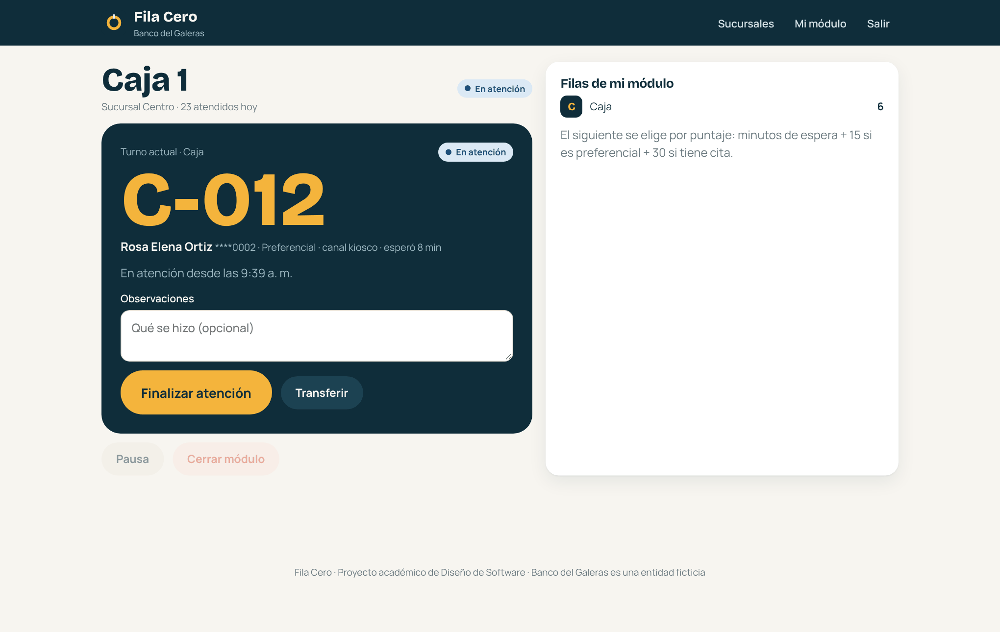

# HU_014 · Atender, volver a llamar y marcar ausente

| Épica | Actor | Prioridad | Puntos | Sprint | Requisitos | Issue |
|---|---|---|---|---|---|---|
| 4. Atención en ventanilla | Asesor | Alta | 3 | 3 | RF_014 | [#14](https://github.com/ManuelVillarreal-l/fila-cero/issues/14) |

## Historia

**Como** asesor,  
**quiero** registrar cuándo llega el cliente, cuándo termino y si no se presentó,  
**para** medir los tiempos y no esperar indefinidamente.

## Criterios de aceptación

```gherkin
Característica: Atender, volver a llamar y marcar ausente

  Escenario: Atención completa
    Dado que llamé un turno
    Cuando el cliente llega y luego termino
    Entonces el turno queda atendido con sus tiempos de espera y de atención

  Escenario: Volver a llamar
    Dado que el cliente no llega
    Cuando vuelvo a llamar
    Entonces el llamado se repite en la pantalla, hasta 3 veces

  Escenario: Ausente
    Dado que llamé 3 veces y el cliente no llegó
    Cuando lo marco como ausente
    Entonces el turno queda ausente y mi módulo libre
```

## Supuestos y notas

- Las observaciones al finalizar son opcionales.

## Validación INVEST

| Criterio | Cumple | Justificación |
|---|---|---|
| Independiente | Sí | Se puede construir y probar sin esperar otras historias de su épica. |
| Negociable | Sí | Describe el qué y el para qué; los detalles de interfaz se acuerdan. |
| Valiosa | Sí | Aporta valor directo a: Asesor. |
| Estimable | Sí | 3 puntos de historia. |
| Pequeña | Sí | Cabe en un sprint de una semana. |
| Testeable | Sí | Tiene criterios Gherkin verificables y pruebas en Postman. |

## Mockup


