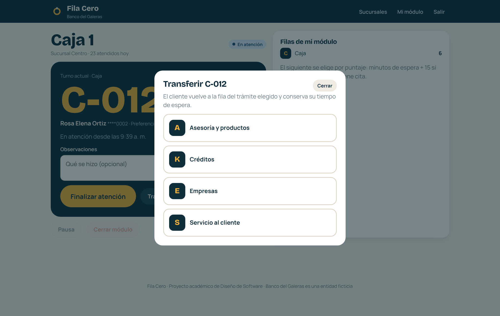

# HU_015 · Transferir turno a otro trámite

| Épica | Actor | Prioridad | Puntos | Sprint | Requisitos | Issue |
|---|---|---|---|---|---|---|
| 4. Atención en ventanilla | Asesor | Media | 3 | 3 | RF_015 | [#15](https://github.com/ManuelVillarreal-l/fila-cero/issues/15) |

## Historia

**Como** asesor,  
**quiero** enviar al cliente a la fila de otro trámite,  
**para** que lo atienda quien corresponde sin que vuelva a empezar.

## Criterios de aceptación

```gherkin
Característica: Transferir turno a otro trámite

  Escenario: Transferir
    Dado que atiendo en Caja a un cliente que necesita un crédito
    Cuando lo transfiero a Créditos
    Entonces recibe un código nuevo K-###
    Y conserva su hora de llegada, así que queda adelante en la fila

  Escenario: Mismo trámite
    Dado que el turno ya es de Caja
    Cuando intento transferirlo a Caja
    Entonces el sistema no lo permite
```

## Supuestos y notas

- Solo se transfiere a trámites que ofrece la misma sucursal.

## Validación INVEST

| Criterio | Cumple | Justificación |
|---|---|---|
| Independiente | Sí | Se puede construir y probar sin esperar otras historias de su épica. |
| Negociable | Sí | Describe el qué y el para qué; los detalles de interfaz se acuerdan. |
| Valiosa | Sí | Aporta valor directo a: Asesor. |
| Estimable | Sí | 3 puntos de historia. |
| Pequeña | Sí | Cabe en un sprint de una semana. |
| Testeable | Sí | Tiene criterios Gherkin verificables y pruebas en Postman. |

## Mockup


