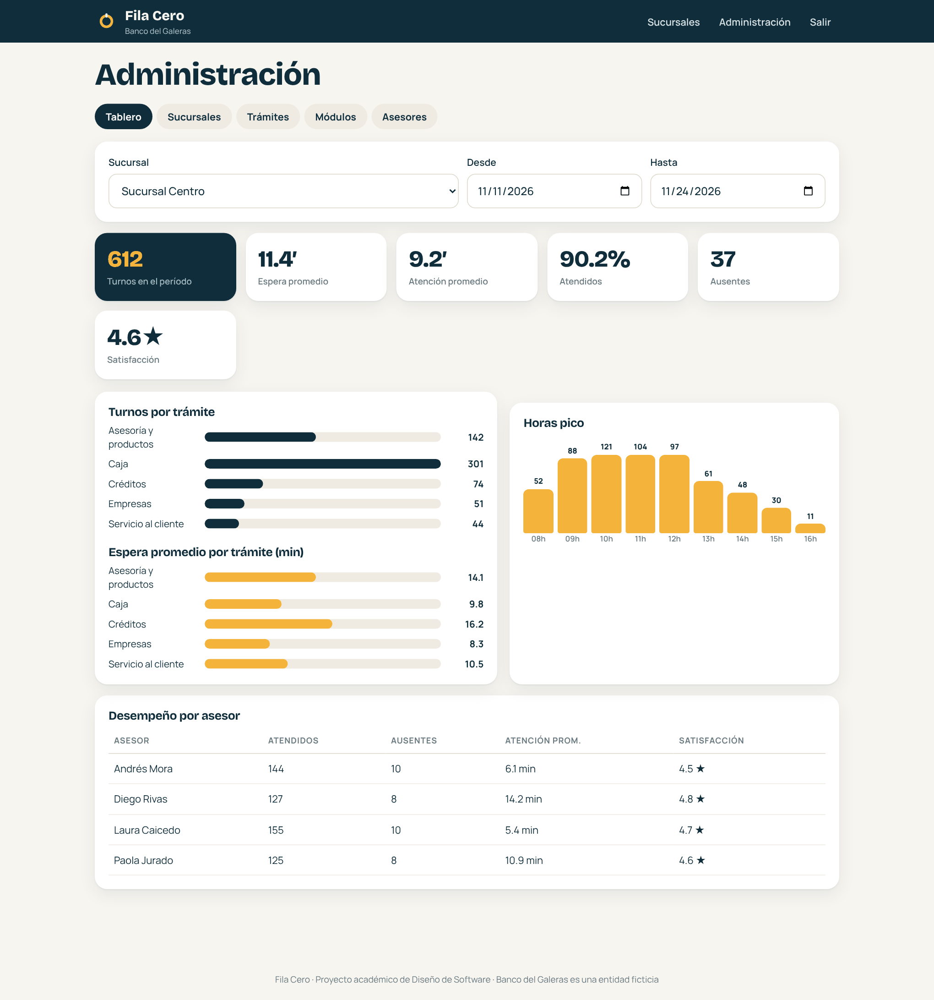

# HU_020 · Consultar el tablero de indicadores

| Épica | Actor | Prioridad | Puntos | Sprint | Requisitos | Issue |
|---|---|---|---|---|---|---|
| 6. Seguimiento | Administrador | Media | 5 | 4 | RF_020 | [#20](https://github.com/ManuelVillarreal-l/fila-cero/issues/20) |

## Historia

**Como** administrador,  
**quiero** ver los indicadores de atención de cada sucursal,  
**para** decidir cuántos módulos abrir y en qué horario.

## Criterios de aceptación

```gherkin
Característica: Consultar el tablero de indicadores

  Escenario: Indicadores
    Dado que elijo la sucursal Centro y los últimos 14 días
    Cuando abro el tablero
    Entonces veo turnos totales, espera y atención promedio, porcentaje atendido, ausentes y satisfacción

  Escenario: Detalle
    Dado que estoy en el tablero
    Cuando reviso el detalle
    Entonces veo los datos por trámite, por asesor y por hora del día

  Escenario: Rango inválido
    Dado que la fecha final es anterior a la inicial
    Cuando consulto
    Entonces veo que el rango no es válido
```

## Supuestos y notas

- El rango máximo es de 92 días.

## Validación INVEST

| Criterio | Cumple | Justificación |
|---|---|---|
| Independiente | Sí | Se puede construir y probar sin esperar otras historias de su épica. |
| Negociable | Sí | Describe el qué y el para qué; los detalles de interfaz se acuerdan. |
| Valiosa | Sí | Aporta valor directo a: Administrador. |
| Estimable | Sí | 5 puntos de historia. |
| Pequeña | Sí | Cabe en un sprint de una semana. |
| Testeable | Sí | Tiene criterios Gherkin verificables y pruebas en Postman. |

## Mockup


